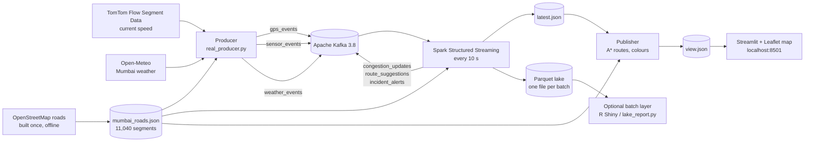
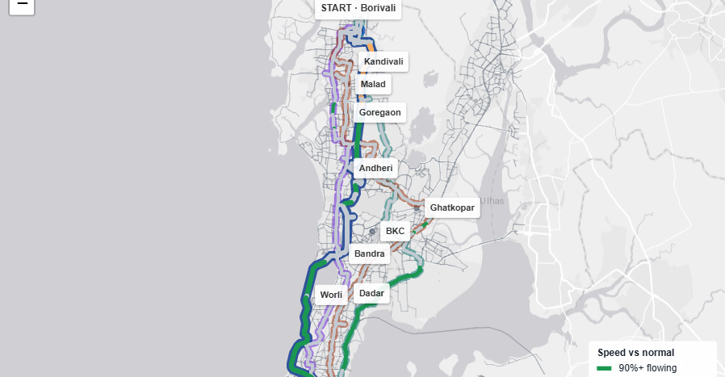
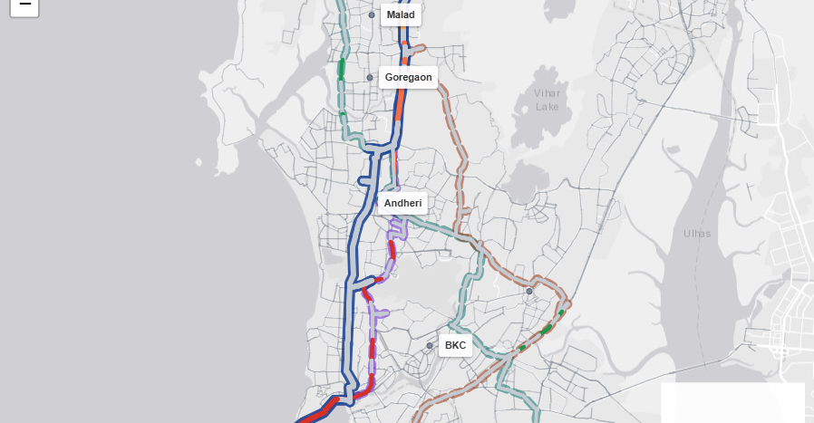

# MapYourWay — Mumbai real-time traffic analytics

Presentation reference. Everything here was taken from the running system on 15 Oct 2026, between about 01:50 and 03:25 IST.

- Dashboard: http://localhost:8501
- Spark UI: http://localhost:4040
- Code: https://github.com/DarshK25/BDA

---

## 1. One sentence

A live pipeline: road speeds and weather for Mumbai go into Apache Kafka, Apache Spark scores congestion on every road segment every 10 seconds, and the dashboard shows that congestion along several complete drives between two places, with the fastest one highlighted.

## 2. The assignment, and how we met it

The brief: design and implement a real-time analytics pipeline for a smart-city transport system that processes live GPS, IoT sensor, and weather data to predict traffic congestion and suggest alternate routes dynamically, using Spark streaming, with congestion updates every few seconds. Kafka and Spark were required.

| What the brief asks for | What we built | Where to point |
|---|---|---|
| Smart-city transport, one real city | Mumbai, Borivali to Colaba plus the eastern suburbs | Map |
| Live GPS data | One GPS-style probe per measured segment, speed from TomTom, on `gps_events` | Kafka sample, section 6 |
| IoT sensor data | Occupancy per segment, on `sensor_events` | Kafka sample |
| Weather data | Open-Meteo Mumbai, on `weather_events` | Kafka sample |
| Apache Kafka | Kafka 3.8, six topics | `docker-compose.yml` |
| Apache Spark streaming | Structured Streaming 3.5.3, `foreachBatch`, 10 second trigger | `streaming/job.py`, Spark UI |
| Congestion updates every few seconds | New Spark batch every 10 s; map polls every 5 s | “Spark update” metric |
| Predict congestion | Random forest next-step forecast trained on the stream | `ml/forecaster.py` |
| Suggest alternate routes dynamically | A* on the live graph, up to four drives, reroute when it saves at least 1 minute | Route table under the map |
| Big data | About 271,000 GPS and 271,000 sensor messages in Kafka, 213,824 rows in the Parquet lake after 90 minutes | Sections 6 and 7 |

The honest limits:

- We do not own GPS trackers or physical road sensors in Mumbai. TomTom’s speed is the measurement. The “sensor” occupancy is calculated from that speed with the Greenshields model.
- TomTom’s free tier allows about 2,500 calls a day, so only some roads have a live sample at any moment.

## 3. Architecture



Plain version:

1. A collector asks TomTom and Open-Meteo what is happening and writes small messages.
2. Kafka holds the messages.
3. Every 10 seconds Spark reads what is new, scores each road segment, and saves the result.
4. The map reads the latest result, times several drives between two places, and colours them.

## 4. Data sources

| Source | What we take | Link | Key | Limit and how we stay inside it |
|---|---|---|---|---|
| TomTom Traffic Flow Segment Data | Current and free-flow speed at a point | https://developer.tomtom.com/traffic-api/documentation/traffic-flow/flow-segment-data | yes, in `.env` | Free tier about 2,500 calls a day. We cap at 2,400, call about every 40 s after a short burst, and cache each answer for 20 minutes. Tonight: 136 calls used. |
| TomTom raster flow tiles | Optional comparison overlay, off by default | https://developer.tomtom.com/traffic-api/documentation/traffic-flow/raster-flow-tiles | same key | Only loaded if “Show provider traffic overlay” is ticked |
| Open-Meteo | Rain, visibility, temperature, humidity for 19.076 N, 72.8777 E | https://open-meteo.com/en/docs | none | Refreshed every 5 minutes |
| OpenStreetMap via Overpass API | Road geometry, names, classes, one-way, maxspeed | https://www.openstreetmap.org, https://overpass-api.de | none | Downloaded once in small tiles; licence ODbL, https://www.openstreetmap.org/copyright |
| Esri World Light Gray Canvas | Basemap: coast, creeks, parks, faint streets | https://server.arcgisonline.com/ArcGIS/rest/services/Canvas/World_Light_Gray_Base/MapServer | none | Map tiles only |

Software:

| Tool | Version | Docs |
|---|---|---|
| Apache Kafka (KRaft, no ZooKeeper) | 3.8.0 | https://kafka.apache.org/documentation/ |
| Apache Spark Structured Streaming | 3.5.3 | https://spark.apache.org/docs/3.5.3/structured-streaming-programming-guide.html |
| Spark–Kafka connector | `spark-sql-kafka-0-10_2.12:3.5.3` | https://spark.apache.org/docs/3.5.3/structured-streaming-kafka-integration.html |
| Python | 3.11 | |
| kafka-python | 2.0.2 | https://kafka-python.readthedocs.io |
| Streamlit | 1.41 | https://docs.streamlit.io |
| Leaflet | 1.9.4 | https://leafletjs.com |
| NetworkX | 3.3 | https://networkx.org |
| scikit-learn | 1.3.2 | https://scikit-learn.org |
| pandas, pyarrow | 2.2.3, 17.0.0 | Parquet lake |
| Docker Compose | | Runs everything |
| R, Shiny, tidyverse, arrow | optional | Batch charts, section 8 |

## 5. Concepts, plain first, then the term

**A message about one road.** “Coastal Road segment w1303398642_0 is at 56 km/h.” The term is an **event**.

**A named queue of those messages.** The term is a **topic**. One program appends, another reads.

**The program that writes them** is the **producer**. Ours is `real_producer.py`.

**The program that reads them** is the **consumer**. Spark is ours.

**The thing that stores the queues** is the **broker**, Kafka. Because Kafka keeps the messages, the producer and Spark never call each other. If Spark stops, messages wait. If the producer stops, Spark gets an empty batch.

**Splitting a topic so it can be read in parallel** is a **partition**. Each topic has 3.

**Spark wakes on a timer and takes everything new.** That is a **micro-batch**, started by a **trigger** of 10 seconds. Each batch has a number, the **epoch**.

**Spark remembers how far it has read** in a **checkpoint**, so a restart does not reread old messages.

**One short piece of a road** is a **segment**. Long roads are many segments, so the colour can change along a drive.

**How fast a segment is when empty** is its **free-flow speed**.

**How full a road is** is **occupancy**. We have no loop detector, so we use the **Greenshields model**: occupancy = 1 − speed / free-flow.

**A number from 0 to 1 for how bad traffic is** is our **congestion score**.

**Junctions as dots, roads as arrows with a travel time** is a **directed weighted graph**.

**Finding the quickest path while aiming at the destination** is **A\*** (A-star). Same search without aiming is **Dijkstra**.

**Guessing the next score from the current one** is a **next-step forecast**. Before training it is **persistence** (next = now). After 400 rows a **random forest** (40 decision trees voting) takes over.

**Files with one column stored together, good for analytics** are **Parquet**. Folder of them over time is our **data lake**.

**A fast live path plus a slower historical path over the same data** is the **lambda architecture** idea: Spark is the speed layer, the lake and R are the batch layer.

## 6. Data structures, real samples

### 6.1 Road network: `src/mapyourway/data/mumbai_roads.json`

Top-level keys: `city`, `source`, `license`, `segments`, `nodes`, `places`, `anchor_ids`.

One segment:

```json
{
  "segment_id": "w38756487_0",
  "osm_way_id": 38756487,
  "name": "Nanabhai Moos Marg (Upper Colaba Road)",
  "road_class": "secondary",
  "node_a": "18.90601,72.81640",
  "node_b": "18.91081,72.82056",
  "length_km": 0.704,
  "free_flow_kmph": 50.0,
  "lanes": 2,
  "oneway": false,
  "delay_s": 10.0,
  "coords": [[18.90601, 72.8164], [18.90694, 72.81672], [18.90718, 72.81694], "..."],
  "mid_lat": 18.90854,
  "mid_lon": 72.81826,
  "inherit": "direct",
  "anchor_segment_id": "w38756487_0"
}
```

- `w38756487` is the OpenStreetMap way id; `_0` is the piece number after splitting at junctions.
- A junction id is just its rounded latitude,longitude: `"18.93048,72.82592"`.
- One place: `{"name": "Borivali", "node_id": "19.23075,72.85665", "lat": 19.23075, "lon": 72.85665, "snap_km": 0.008, "road_rank": 4}`. Borivali snapped to a junction 8 m away.

Size and mix:

| Item | Count |
|---|---|
| OpenStreetMap ways downloaded | 11,915 |
| Segments after splitting | 11,040 |
| Junctions | 8,623 |
| Total length | about 2,259.5 km |
| Named places | 35, Dahisar to Colaba, plus Sion, Kurla, Chembur, Ghatkopar, Vikhroli, Powai, Mulund |
| TomTom anchors | 36 |

| Road class | Segments | Default free-flow |
|---|---|---|
| tertiary (local streets) | 4,749 | 30 km/h |
| secondary | 2,658 | 35 km/h |
| primary | 1,883 | 45 km/h |
| trunk | 767 | 60 km/h |
| trunk_link | 312 | |
| motorway | 253 | 70 km/h |
| motorway_link | 166 | |
| primary_link | 143 | |
| secondary_link | 73 | |
| tertiary_link | 36 | |

An OpenStreetMap `maxspeed` tag overrides the default.

### 6.2 Kafka topics

| Topic | Direction | Partitions | Messages stored at 03:20 IST |
|---|---|---|---|
| `gps_events` | in | 3 | 271,389 |
| `sensor_events` | in | 3 | 271,389 |
| `weather_events` | in | 3 | 512 |
| `congestion_updates` | out, from Spark | 3 | 210,536 |
| `route_suggestions` | out, from Spark | 3 | 1,576 |
| `incident_alerts` | out, from Spark | 3 | 0 (nothing became severe tonight) |

Retention is 6 hours. Inside Docker the broker is `kafka:9092`; from Windows, `localhost:29092`.

Real messages, read with `kafka-console-consumer.sh`:

`gps_events`

```json
{"vehicle_id": "PROBE-w207416557_0", "segment_id": "w207416557_0", "lat": 18.91159, "lon": 72.82122,
 "speed_kmph": 50.0, "speed_source": "tomtom_same_road", "ts_ms": 1792014623196}
```

`sensor_events`

```json
{"sensor_id": "INFERRED-w38756487_1", "segment_id": "w38756487_1", "occupancy_pct": 0.0, "vehicle_count": 4,
 "inference": "greenshields_from_speed", "speed_source": "tomtom_same_road", "ts_ms": 1792014633556}
```

The `PROBE-` and `INFERRED-` prefixes and the `inference` field say openly that these are derived, not physical devices.

`weather_events`

```json
{"station_id": "OPEN-METEO-MUMBAI", "rain_mm_hr": 0.0, "visibility_km": 14.1, "temp_c": 28.5,
 "humidity_pct": 58.0, "source": "open-meteo", "observed_at": "2026-10-15T03:15", "ts_ms": 1792014644194}
```

`congestion_updates` (written by Spark)

```json
{"segment_id": "w207416557_0", "name": "Nanabhai Moos Marg (Upper Colaba Road)", "road_class": "secondary",
 "measured_speed_kmph": 50.0, "speed_kmph": 50.0, "free_flow_kmph": 50.0, "occupancy_pct": 0.0,
 "vehicle_count": 4, "congestion": 0.0, "forecast": 0.0, "level": "low",
 "speed_source": "tomtom_same_road", "probes": 1, "ts_ms": 1792014633556}
```

`route_suggestions` (written by Spark, shortened)

```json
{"origin": "Bandra", "destination": "Ghatkopar", "usual_min": 24.2, "best_min": 24.2, "saving_min": 0.0,
 "reroute": false,
 "usual_label": "Western Express Highway → BKC - Sealink Road → BKC Flyover → … → V B Phadke Marg → Lal Bahadur Shastri Marg",
 "best_segment_ids": ["w46417988_0", "w46417990_0", "w960010719_0", "..."]}
```

### 6.3 Producer state: `data/export/producer_status.json`

```json
{"updated_at": "2026-10-14T21:55:18Z", "anchors_total": 36, "anchors_fresh": 27,
 "tomtom_calls_today": 136, "tomtom_daily_budget": 2400, "segments": 11040,
 "weather": {"station_id": "OPEN-METEO-MUMBAI", "rain_mm_hr": 0.0, "visibility_km": 14.1, "temp_c": 28.5, "...": "..."},
 "last_error": null}
```

TomTom cache entry (`data/export/tomtom_cache.json`, key removed):

```json
{"w1303398642_0": {"speed_kmph": 60.0, "free_flow_kmph": 60.0, "fetched_at": 1792014887.27, "name": "Mumbai Coastal Road"}}
```

### 6.4 Spark output: `data/export/latest.json`

One file, rewritten every batch: `updated_at`, `epoch`, `weather`, `weather_factor`, `model` (`kind`, `rows`, `mae`), `segments` (one entry per scored segment, same fields as `congestion_updates`), `routes` (four headline trips), `new_severe`.

### 6.5 Parquet lake: `data/lake/segment_congestion/epoch-000NNN.parquet`

One file per Spark batch. Columns:

`segment_id, name, road_class, measured_speed_kmph, speed_kmph, free_flow_kmph, occupancy_pct, vehicle_count, congestion, forecast, level, speed_source, probes, ts_ms, epoch, rain_mm_hr`

### 6.6 Map file: `src/mapyourway/dashboard/static/view.json`

Written every few seconds by the publisher. `segments` (only the roads on the shown drives, with `band`, `band_color`, `ratio`, `speed`), `route` (usual, best, and `corridors`: each with `role`, `minutes`, `km`, `label`, `line`, `pieces`, `band_km`), `sampled_total`, `scenario`.

## 7. Processing, step by step

### Step 1 — collect (`src/mapyourway/simulator/real_producer.py`)

- 36 TomTom anchors spread across the city. Short burst at start, then about one call every 40 seconds. Daily cap 2,400. Answers cached 20 minutes.
- Each anchor gives a speed ratio, current / free-flow. A named road within 4 km of an anchor borrows that ratio (`tomtom_same_road`). The anchor itself is `tomtom_direct`.
- For every measured segment, every 10 seconds: one `gps_events` message and one `sensor_events` message.
- Streets with no sample are not published. 11,040 segments every 10 seconds would flood Kafka. The router still knows them at free-flow speed.
- Weather to `weather_events` every cycle, refreshed from Open-Meteo every 5 minutes.

### Step 2 — hold (Kafka)

Six topics as in 6.2. Created once by the `kafka-init` service in `docker-compose.yml`.

### Step 3 — score (`streaming/job.py` starts it, `streaming/process.py` does the work)

Spark reads the three input topics. Every 10 seconds `process_batch` runs on the new rows:

1. Average the GPS speeds per segment.
2. Weather factor: `0.7 × rain/25 + 0.3 × (10 − visibility)/10`, each part capped between 0 and 1.
3. Adjusted speed: `measured × (1 − 0.35 × weather_factor)`. Heavy rain and fog can cut it by up to 35%.
4. Occupancy from the sensor event, or Greenshields if missing.
5. Score: `0.75 × (1 − adjusted / free_flow) + 0.25 × occupancy / 100`, kept between 0 and 1.
6. Level: under 0.30 low, under 0.55 medium, under 0.75 high, otherwise severe.
7. A segment that has just become severe is written to `incident_alerts`.
8. The forecaster learns from the previous batch and predicts the next score.
9. Route check for four headline trips: Borivali–Colaba, Andheri–Nariman Point, Bandra–Ghatkopar, Dadar–BKC.
10. Write `latest.json`, one Parquet file, and the three output topics. If writing to Kafka fails, the file is already saved.

### Step 4 — route (`src/mapyourway/routing.py`)

- Edge time in minutes = length / speed × 60, plus a junction delay per class (tertiary 22 s, secondary 10 s, primary 6 s, trunk 1 s, motorway 0 s). That stops a path zigzagging through lanes unless the highway is really worse.
- Motorways and trunks are one-way. Smaller one-way streets are opened in both directions, because in OpenStreetMap the opposite side of a street is often a separate way that never meets it. Without this there is no drivable path from Borivali to Colaba.
- Dead ends within 20 m are joined. Flyovers are not glued to the street below.
- **Usual route:** quickest path when every road is empty, then re-timed at live speeds.
- **Best route:** A* at live speeds. The guess is straight-line distance at the city’s top speed, which never overestimates, so the answer is exact.
- **Alternatives:** make the roads of the routes already found four times slower in a copy of the graph, search again, keep it if it is at least 20% different, and time it at the real speeds. Up to four drives.
- **Reroute** when the best route is different from the usual one and saves at least 1 minute.
- Tonight A* expanded 5,848 junctions for Borivali–Colaba; Dijkstra expanded 7,194 for the same answer.

### Step 5 — show (`dashboard/publisher.py`, `dashboard/app.py`)

- The publisher reads `latest.json`, runs the routes for the sidebar trip, and writes `view.json`.
- The map polls `view.json` every 5 seconds without reloading the page, so pan and zoom stay put.
- Streets that are not on a candidate drive are muted gray.
- Each piece of each drive is coloured by its speed versus its own free-flow speed:

| Live speed / normal | Colour | Label |
|---|---|---|
| 90% or more | green | flowing |
| 80–90% | light green | slightly slow |
| 70–80% | orange | slow |
| 55–70% | dark orange | very slow |
| under 55% | red | jammed |
| no sample | light gray | no sample |

Spark’s own levels are coarser. A road above about 70% of normal is “low”, which is why we use the ratio on the map. It is the same live number, cut into finer bands.

- Solid blue border: best route. Dashed coloured borders: other drives. Blue START and red END markers. Locality labels.
- Under the map, a table per drive: minutes, extra minutes against the best, and kilometres flowing, slightly slow, slow or worse, and with no sample.

## 8. The R part, and why it is there

**What it is.** Three files in `r/`:

- `common.R` loads the data and makes the shared columns.
- `analysis.R` is a one-off report: summary per road, top 5 congested hours, top 10 congested roads, day-of-week pattern. It saves PNG charts and a JSON file in `data/reports/`.
- `app.R` is a Shiny dashboard on port 3838 with tabs for overview, roads, time patterns, and raw data.

**Why it exists.** Spark answers “what is happening right now”. R answers “what happened over hours and days”: which hour is worst, which road is usually slowest. That historical side is the batch layer. It reads the same Parquet lake Spark writes. It is not in the problem statement and it is not needed for the live demo.

**Where it stands.**

- It is not running. The R image (`rocker/shiny` plus tidyverse and arrow) has not been built, and building it downloads and compiles many CRAN packages.
- It was written for an older CSV. I changed `common.R` and `app.R` tonight so they read the Spark lake folder (`/data/lake/segment_congestion`) and map our columns: `speed_kmph` → `avg_speed`, `congestion` → `congestion_level`, `ts_ms` → `timestamp`, `segment_id` → `road_id`. This has not been run in R yet.
- To try it later:

  ```powershell
  docker compose --profile r up -d r-analytics      # Shiny on http://localhost:3838
  docker compose --profile r run --rm r-report      # PNG and JSON report in data/reports
  ```

**The same batch analytics, actually run.** `scripts/lake_report.py` does the same kind of summary in Python inside the app image and was run on the lake at about 03:21 IST:

```powershell
docker run --rm -v "${PWD}/data:/data" -v "${PWD}/src:/app/src" -v "${PWD}/scripts:/app/scripts" -e PYTHONPATH=/app/src mapyourway-app python /app/scripts/lake_report.py
```

| Measure | Value |
|---|---|
| Parquet files (Spark batches) | 400 |
| Rows | 213,824 |
| Distinct segments | 548 |
| Distinct named roads | 28 |
| Time span | 01:51 to 03:21 IST |
| Average segments per batch | 534.6 |
| Rows by source | 200,668 same-road, 13,156 direct TomTom |
| Rows by level | 212,856 low, 968 medium |

| Hour (IST) | Rows | Avg congestion | Avg speed / normal |
|---|---|---|---|
| 01:00 | 14,791 | 0.000 | 1.00 |
| 02:00 | 144,024 | 0.010 | 0.99 |
| 03:00 | 55,009 | 0.029 | 0.97 |

Slowest roads over that window:

| Road | Segments | Avg speed | Avg speed / normal | Avg congestion | Worst |
|---|---|---|---|---|---|
| Kapurbawdi Flyover | 4 | 39.4 km/h | 0.79 | 0.213 | 0.363 |
| Western Express Highway | 136 | 58.7 km/h | 0.95 | 0.047 | 0.238 |
| Mumbai Coastal Road | 45 | 75.2 km/h | 0.99 | 0.008 | 0.067 |

Everything else sampled was at its normal speed. That is what 2–3 am in Mumbai looks like. The output is saved to `data/reports/lake_summary.json`.

## 9. Maps

Live state, Borivali to Colaba, around 03:20 IST. Gray streets are the network outside the trip. The coloured pieces are the four drives. The solid blue border is the fastest drive; dashed borders are the alternatives. Almost all sampled pieces are green because the city is empty.



With the demo switch on (“Simulate a Western Express Highway jam (demo)”). Only the Western Express Highway and Sea Link are slowed, to 30–75% of normal. You can see orange and red pieces along the highway near Andheri and Bandra, and the best route moving off it. In the test run the usual drive went from about 71 to 88.5 minutes, and the best drive took 81.6 minutes, saving 6.9 minutes. A yellow warning on the page says this is a what-if. Kafka, Spark, and the lake are not changed.



## 10. Problems we hit, and what fixed them

| # | Problem | Fix |
|---|---|---|
| 1 | The project would not run: no dashboard app, no Spark job, imports still pointed at an older package `cgls` | Wrote `dashboard/app.py`, `streaming/job.py`, `streaming/process.py`; fixed imports to `mapyourway` |
| 2 | Producer and Spark used different topic names and a missing `KAFKA_BOOTSTRAP` setting | One config file, topics `gps_events`, `sensor_events`, `weather_events`, and the three outputs |
| 3 | Map stuck on “API key required … carto.com/basemaps” | Carto’s no-label tiles return HTTP 200 but the picture is a watermark. Switched to Esri Light Gray Canvas, which needs no key |
| 4 | Basemap streets drawn under our streets, hard to tell apart | Gray canvas basemap; our streets outside the trip in muted gray; colour only on the drives |
| 5 | Only main roads, no local streets for detours | Downloaded every motorway to tertiary street from OpenStreetMap: 11,915 ways, 11,040 segments |
| 6 | Overpass API timed out or rate-limited (HTTP 504, 429) on a whole-city query | Small tiles, 8 s pause, rotating mirrors, resume file. The first run failed; the resumed run finished |
| 7 | The office network intercepts HTTPS, so Python rejected certificates for Overpass, TomTom, and Open-Meteo | For these public APIs only, retry once without certificate verification and log a warning |
| 8 | Graph split into 406 islands; no path from Borivali to Colaba | Join dead ends within 20 m; open minor one-way streets both ways; keep motorways and trunks one-way |
| 9 | k-shortest paths was too slow on 11,000 edges | Penalised re-search for alternatives; later, change weights on one copy of the graph so four drives take about 2 seconds |
| 10 | TomTom free tier too small for 11,040 segments | 36 anchors, same-road ratio within 4 km, 20 min cache, daily cap 2,400 |
| 11 | Publishing every segment every cycle would flood Kafka | Publish only measured segments; router uses free-flow for the rest |
| 12 | One bad TomTom point (HTTP 400) paused all calls for 90 s | Back off only on HTTP 429 |
| 13 | Streamlit serves static JS as plain text, so the browser would not run the map library | Fetch the file and run it in the page; inject the CSS |
| 14 | MapLibre loaded all 11,040 roads but never drew them (its background worker never finished in this setup) | Switched to Leaflet, which draws on the main page |
| 15 | Page refresh reset pan and zoom every few seconds | Map polls `view.json` every 5 s instead of reloading the page |
| 16 | Code edits on Windows not picked up inside Docker | `docker restart mapyourway-dashboard` after a change |
| 17 | Every route was green | Spark’s “low” covers anything above about 70% of normal. Map now uses finer speed-ratio bands; a labelled what-if switch shows a jam at night |
| 18 | Whole route drawn in one colour | Colour each segment of each drive separately |
| 19 | Random forest error 0.0 looked too good | It is real: at night the next score equals this score. The page says so; it is not a benchmark |
| 20 | GitHub push refused (HTTP 403) | Added as collaborator, signed in through Git Credential Manager, pushed |
| 21 | R scripts expected an old CSV with other column names | `common.R` now reads the Parquet lake and maps our columns. Not yet run in R |

## 11. Demo script

1. `docker compose ps` — four containers up: kafka (healthy), simulator, spark, dashboard. If not: `docker compose up -d`.
2. Open http://localhost:4040 — Spark UI, Structured Streaming tab, batches every 10 s.
3. Open http://localhost:8501 — From Borivali, To Colaba. Local streets on, provider overlay off, demo switch off.
4. Read the metrics: Spark update a few seconds ago, roads measured, severe count, average measured speed, Mumbai weather.
5. Map: gray city, coloured drives, legend bottom right, START and END markers.
6. Route table: the best route and how much slower each alternative is, and kilometres in each speed band.
7. Model caption: persistence or random forest, rows, holdout error, and why it is near zero at night.
8. Tick the demo switch. Wait about 10 seconds. Show orange and red on the highway and the best route changing. Say that it is a what-if.
9. Untick it. Optional: tick the provider overlay to show TomTom’s own tiles as a second opinion.
10. Optional: show one Kafka message:

    ```powershell
    docker exec mapyourway-kafka /opt/kafka/bin/kafka-console-consumer.sh --bootstrap-server localhost:9092 --topic gps_events --max-messages 1
    ```

## 12. Voiceover, about 90 seconds

“Two live sources feed this system. TomTom gives the current speed on a sample of Mumbai roads, and Open-Meteo gives the weather. A producer turns those into GPS, sensor, and weather events and writes them to Kafka. Kafka holds the events, so collecting and analysing are separate programs. Every 10 seconds Spark Structured Streaming reads a micro-batch. It lowers the believable speed when it rains or visibility drops, estimates how full each road is with the Greenshields model, and gives every road segment a congestion score. It saves the batch to a Parquet lake and writes the scores back to Kafka. The map takes that latest result. Our OpenStreetMap network of eleven thousand segments, including local streets, is drawn in gray. A-star finds the fastest drive at the current speeds, and then forces itself off that corridor to find other complete drives. Each piece of each drive is coloured by its speed against normal. The solid border is the fastest. At three in the morning the city is clear, so the usual road wins. When the Western Express Highway slows down, the search moves the suggested drive off it.”

## 13. Questions you may get

**Is the GPS real?** The speed is real, from TomTom. We publish it as one GPS-style probe per measured segment. We do not have our own trackers.

**Are the sensors real?** No physical sensors. Occupancy is calculated from speed with the Greenshields model, and the message says `"inference": "greenshields_from_speed"`.

**Why are only about 548 segments sampled?** TomTom’s free tier is about 2,500 calls a day. We sample 36 anchors and spread each result along the same named road nearby. The rest are drawn and routable at free-flow speed, shown light gray on a drive.

**Why Kafka?** It separates collecting from analysing. Either side can stop or restart. The broker absorbs bursts and keeps a replayable history.

**Why Spark if the formula is simple?** The formula is the analysis. Spark runs it continuously on every micro-batch, keeps its place with checkpoints, writes the lake, and publishes the outputs. The same job would scale to more partitions and machines.

**How is the congestion predicted?** A random forest learns from the stream how the score moves from one batch to the next. Until it has 400 rows it uses persistence.

**Why is the model error zero?** At night speeds do not change between batches, so the next score equals this one. It will rise in the daytime.

**A-star versus Dijkstra?** Same route here; A-star checked 5,848 junctions, Dijkstra 7,194.

**Why are some one-way streets two-way in the graph?** Otherwise the two sides of many streets never connect and there is no route. Motorways stay one-way.

**What does R do?** Optional batch layer for historical charts over the Spark lake. Not running in this demo; `lake_report.py` produced the historical numbers in section 8.

**What happens if a container dies?** `restart: unless-stopped` brings it back. Spark resumes from its checkpoint.

## 14. Files to open if asked for code

| File | Role |
|---|---|
| `docker-compose.yml` | Kafka, topic setup, producer, Spark, dashboard, optional R |
| `scripts/fetch_osm_roads.py` | Download Mumbai roads from Overpass in tiles |
| `scripts/build_network.py` | Split, weld, anchors, places → `mumbai_roads.json` and `network.geojson` |
| `src/mapyourway/network.py` | Loads the network |
| `src/mapyourway/simulator/real_producer.py` | TomTom, Open-Meteo, Kafka producer |
| `src/mapyourway/streaming/job.py` | Spark read from Kafka, 10 s trigger, checkpoint |
| `src/mapyourway/streaming/process.py` | Score, forecast, lake, output topics |
| `src/mapyourway/ml/forecaster.py` | Persistence, then random forest |
| `src/mapyourway/routing.py` | Graph, A*, Dijkstra, alternate drives |
| `src/mapyourway/dashboard/publisher.py` | Speed bands, route pieces, demo jam |
| `src/mapyourway/dashboard/app.py` | Streamlit page and Leaflet map |
| `scripts/lake_report.py` | Batch summary over the Parquet lake |
| `r/common.R`, `r/analysis.R`, `r/app.R` | Optional R batch layer |

## 15. What not to claim

- We did not deploy GPS trackers or road sensors.
- Not every street has a live sample.
- The random-forest error is not a published accuracy.
- The jam switch is a what-if, not live traffic.
- R is not running and is not the real-time part.
- The basemap is Esri, not Carto.
